# Canvas v2 shell, design system and tool rework

Status: planned 6 November 2026, built 7 November 2026 on the `canvas-v2-shell` branch. The plan is the contract for the builders; the mockups in this folder are the contract for how it looks. Phase two (section 8.5) is not started.

### Built

| Step | Commit | What landed |
|---|---|---|
| Plan | 793c296 | This plan and the three mockups |
| 1 | 44ba773 | `theme/tokens.css`, Tailwind on the v2 names only, Moss removed |
| 2 | fea8832 | shadcn primitives regenerated into `ui`, the old ui folder deleted |
| 3 | 2812ce9 | The composites in `editor/components`, each with a test |
| 4 | aab249c | The `/gallery` development route |
| 5 | 1fd4e24 | Registry types, rules test, settings slice with zod writes |
| 6 | ae38d2d | Shell surfaces from the registry |
| 10 | 8a759f8 | Design family: Floor, Wall, Door, Elevation |
| 7 | ef1b96f | Select family: panel, Pick only, cards, Mixed card |
| 11 | f02a36d | Terrain family, strength that works |
| 8 | 154c320 | Asset panel on demand, clear of the dock |
| 9 | 4151ce7 | Rail, family, tool and dock keys from the registry |
| 12 | 4a7b39f | Objects family: Stamp and Scatter over one pool |
| Parity | 0e815ee | Layers column, sheets, menus and status bar level with the old editor |
| 13 | 68debe0 | Environment family, Sky and mood rebuilt, map migration |
| 14 | f1e4697, d3fb477 | Text family: labels, zones, rooms, rooms list and zone sheets |
| 15 | this commit | The shell at the root; home in `src/home`, dialogs in `editor/dialogs`, overlays beside the canvas host; `src/v2`, its CSS, `/next` and the stub registry deleted; the Playwright suite rewritten into one spec per scope with scope tags (`pnpm -C canvas e2e --grep @design`). Fixed on the way: a reopened map no longer reads as changed to Publish, Auto focus fades the chrome again, Escape closes a menu or popover before the sheet under it, Scatter has its Erase switch and Shift E works, the group card is back, a label that finds no door or room says why, and Replace opens the library |

Screenshots of each step are in [steps](steps/). The home page is not mocked: it is today's layout carried over one to one onto the tokens.

## TL;DR

The editor keeps its canvas and store but gets a new shell. The left rail owns the tool families (Design, Terrain, Objects, Environment, Text) with Select, Pan and Measure above them. Clicking a family opens a flyout beside the rail; picking a tool turns that same box into the tool's panel, which holds how the tool behaves. The dock at the bottom holds what the tool uses (swatches, materials, assets, level and layers) plus on-the-fly controls (shape, size, rotate, curve, node mode). Select is a tool like any other: its panel is the selection card. The asset library opens on demand on the right and never covers the dock. The home button lives in the map-name card, undo, redo, the menu and Publish stay top right, help is a question mark at the end of the status bar.

Underneath, there is one design system: the v2 neutral tokens (no accent, outline for active), IBM Plex Sans and Mono, a 4px grid, three control heights. It is built on the shadcn primitives already installed, with a small set of composite components that every surface uses. The Moss theme, the hand-written v2 CSS files, the local controls file and the old shared ui folder all go.

Tools and their settings become data: a registry per family with a zod schema, a default and a home (panel, dock or card) for every setting. The panel, dock and card render from it, so a setting exists once. Settings were audited one by one against Dungeondraft: 77 keep, 17 drop, 6 move, 30 add. The adds that need renderer work (water brush, path, material brush, carve out, corner style, colour per region) are a later phase with their own Dungeondraft references.

Three builders: one on the foundation (tokens, primitives, composites, gallery), one on the shell and registry, one on migrating the families and applying the audit. Foundation lands first, the other two run in parallel on top of it where their files do not collide, then one integration pass deletes the old code. All of it on one local branch, one commit per step, each tested with vitest and Playwright and green on `pnpm check`.

## 1. What we want

These are the decisions as said, with the date. They are the brief; where the plan and a quote disagree, the quote wins.

- "Dock stays but the tooling might be different. We'll definitely use the dock for swatches, assets and layers etc." (6 Nov)
- "We're gonna have a floating left side bar as well along with the selected left rail option. Something like DungeonDraft's left rail." (6 Nov)
- "The left panel holds how the tool behaves, meaning size, intensity, snap, curve, erase, door swing, light radius. The dock holds what the tool uses, meaning swatches, materials, the asset strip, and the layer and level filmstrip. Nothing appears in both." Answered: "YES". (6 Nov)
- Refined the same day: "Swatches changes for the same tools can be on the dock and things like on the fly size / rotate / transform / node mode / etc can be on the dock for on the fly updates." So the dock is swatches plus on-the-fly controls; the panel is setup.
- "Plateaus will be part of the Design tools, called Elevation maybe?" (6 Nov)
- "Rooms can go under Label tools with Zones / Prep etc." The family name stays Text: "Keep it texts for now." (6 Nov)
- "Erase is a mode and Measure (Ruler) can go w Select / Pan." (6 Nov)
- "Select on left panel, sure." (6 Nov)
- "Asset library not always open. Open on demand yes." (6 Nov)
- "Panel 3 and 4 are one after the other not side by side." The flyout and the tool panel share one slot. (6 Nov)
- "The Asset Panel should not cutoff the bottom dock." (6 Nov)
- "The home button and name of the map are together not separate." (6 Nov)
- Dock while Select is active: "keep the last family's swatches so a quick 'pick a texture, paint' stays one click away." (6 Nov)
- Panel while painting: "yes stay open so users can change settings mid painting if they want and not have to click multiple times again." (6 Nov)
- Flyout trigger: "On click." (6 Nov)
- Assets: "Material Swatches in the dock is fine but the Assets Panel will have everything too. All kinds of props, some will be color changable, some will be stamp scatter, some for floor walls etc." (6 Nov)
- Help: "Have a '?' icon for the shortcuts modal to open." Placement: "bottom right is fine / can be inside the ... on top left menu." (6 Nov)
- Shortcut letters: shown at the icon's corner everywhere, rail, flyout, dock, action bar. "Yes." (6 Nov)
- Active state: "No Active tint just the outline for now is fine." (6 Nov)
- Floor shapes: "Yes they're all the same tool, shouldn't be separate tbh." One Floor tool with a shape row. (6 Nov)
- Floors without walls: "yes some floors HAS to be without walls right, like the base initial terrain as well, nothing draws on it yet as floor we need something." Floors stay floor only; Rooms draw walls. (6 Nov)
- Corner style: "YES we need the full wall sets for this right from the beginning so walls can have curved edges and sharp edges when needed." (6 Nov)
- "Opacity on floors also has to work, even the terrain brush strength / opacity / fill slider doesn't work." (6 Nov)
- Door material and hinges: "Material / Hinges are all assets for the doors, if present they should be there - if the assets not present we will have some default ones in the packs right? but should be customisable." (6 Nov)
- Colour controls: "yes some textures and assets are multi color as well. Need proper coloring controls for them if customisable." (6 Nov)
- "Below water tool - yes, after a similar well made Water tool exists." (6 Nov)
- Glows: "Two systems for one glow is one too many. - yes." Dropped. (6 Nov)
- Environment: "YES, we need to fix this complete environment BS - the moon phases differences nothing + time of day is rarely useful if not customisable." (6 Nov)
- "Light shape - skip for now, later when assets arrive." (6 Nov)
- "Climate - they dont change / do anything yet on the made map - not needed unless customisable." (6 Nov)
- "Same with Mood - does not change alot - remove it IF it does not affect alot. Useless rn." (6 Nov)
- "All the 10 in drops are droppable." (6 Nov)
- "Yes we definitely need the material brush right, its like scatter tool but fuller." (6 Nov)
- "All okay for the moves and adds now - looks fine." (6 Nov)
- Design system: "the frontend design system has to be from a well defined modularised component library ... something like say ShadCN or something better because randomly assigning these root level components will make everything look different." Then: "Keep ShadCN but for each component like the 'icon with the shortcut' or even higher components. We need to follow UI/UX principles for spacing, alignments, and other things vigilantly." (6 Nov)
- Moss theme: gone. "get the v2 design system and colors verified by me and get rid of the old files pls." (6 Nov)
- Old ui folder: "Rebuild new ones - remove old ones completely." (6 Nov)
- Scope: "For now just the canvas - after canvas launches - we're gonna get the table as well to this similar UI feel with updated UX." (6 Nov)
- "The frontend code and components HAVE to be modularised." So that adding gates later "is not a complete frontend rewrite of IF conditions on every line." (6 Nov)
- "Entitlement / RBAC / anything like that is not in the application yet - ALL of it is for everyone who can use." (6 Nov)
- "I want it all shown as mockups and not random text on audit page so I know EXACTLY how itll look and feel." (6 Nov)
- Icon buttons: "maybe stretch the icon in the button a little to the top left (a little) so it looks better OR improve the padding so it looks and reads clearer." And: "Padding and Alignment and spacing needs to be fixed in other components as well like Pills Buttons Inputs etc." (6 Nov)
- Rail: "Icons on the left rail look cramped up - give me more space / breathing room - ALL FRAMES." (6 Nov)

## 2. What we do not want

- No dock tabs. The rail owns the family; the dock follows it.
- No selection card on the right. Select's panel is the card.
- No accent colour and no filled active state. Active is a 1.5px inset ring in the ink colour.
- No global Erase or Curve modes on the rail. Erase is a per-tool mode in the panel. Curve is a per-tool toggle in the dock until node editing has midpoint handles, then it goes.
- No setting defined twice. If it is in the panel it is not in the dock, and the other way round.
- No hand-written CSS files per feature, no local control libraries, no raw `<button>`, `<input>` or `<select>` in editor code.
- No hidden held-key chords as the only way to do something. A held key may be a shortcut for a visible mode, never the mode itself.
- No settings that change nothing on the made map. Climate, weather, moon phase, time of day, night only, darkvision and room Mood go.
- No cave brush. Floors plus Carve out plus the cave band renderer cover it.
- No light shapes yet, no below-water layer until the water brush is good.
- No entitlements, roles or paywall code. Everything is for everyone.
- No text-only deliverables for anything visual. Mockups first, then code that matches them.
- Nothing on GitHub mentions tooling. Commits and PR bodies in the first person, under 100 words.

## 3. References

Mockups, kept in this folder so they survive. Open them in a browser; they are single files and the same pages that were reviewed and approved.

| What | File here |
|---|---|
| Design system: tokens, type, spacing, every control, light and dark side by side | [mockups/design-system.html](mockups/design-system.html) |
| Shell mockup, round two: four frames of the editor | [mockups/shell.html](mockups/shell.html) |
| Tool settings audit: every setting, verdict, home and the case for it | [mockups/settings-audit.html](mockups/settings-audit.html) |
| Phase two: one frame per item, drawn on the shipped shell | [mockups/phase-2.html](mockups/phase-2.html) |

Dungeondraft encyclopaedia, the reference for how each tool behaves and which settings it exposes. Read the page before building the matching tool.

| Family | Pages |
|---|---|
| Design | [Design tab](https://dungeondraft-encyclopaedia.gitbook.io/guide/all-the-tools/design-tab): Building tool, Wall tool, Portal tool, Cave brush, Pattern shape tool, Roof tool |
| Terrain | [Terrain tab](https://dungeondraft-encyclopaedia.gitbook.io/guide/all-the-tools/terrain-tab): Terrain brush, Water brush, Material brush, Path tool |
| Objects | [Objects tab](https://dungeondraft-encyclopaedia.gitbook.io/guide/all-the-tools/objects-tab): Objects tool, Scatter tool |
| Environment | [Effects tab](https://dungeondraft-encyclopaedia.gitbook.io/guide/all-the-tools/effects-tab): Light tool, Environment |
| Text | [Text tool](https://dungeondraft-encyclopaedia.gitbook.io/guide/all-the-tools/text-tool) |
| Select | [Select tool](https://dungeondraft-encyclopaedia.gitbook.io/guide/all-the-tools/select-tool): left tab, interactive areas, contextual controls |
| Levels, trace image | [Settings tab](https://dungeondraft-encyclopaedia.gitbook.io/guide/all-the-tools/settings-tab) |
| Prefabs | [Prefabs tool](https://dungeondraft-encyclopaedia.gitbook.io/guide/all-the-tools/prefabs-tool) |

Code that exists today and is the starting point:

| Area | Where |
|---|---|
| Editor chrome | `canvas/src/v2/editor/EditorShell.tsx`, `Rail.tsx`, `TitleCard.tsx`, `TopActions.tsx`, `Dock.tsx`, `DockControls.tsx`, `StatusBar.tsx`, `SlideOver.tsx`, `FloatMenu.tsx`, `TipLayer.tsx` |
| Tool tabs and settings | `canvas/src/v2/editor/dockTabs.ts`, `DockControls.tsx`, `LightsDock.tsx`, `PropsDock.tsx`, `RoomsDock.tsx`, `PlateauFields.tsx` |
| Selection cards | `canvas/src/v2/editor/SelectionCard.tsx`, `CardActions.tsx`, `LabelCard.tsx`, `LightCards.tsx`, `PropCards.tsx`, `RoomCards.tsx`, `MixedCard.tsx` |
| Sheets | `LayerSheet.tsx`, `LayersSheet.tsx`, `SkySheet.tsx`, `PacksSheet.tsx`, `ShortcutsSheet.tsx`, `RoomsSheet.tsx`, `ZoneSheet.tsx`, `PrepOverview.tsx`, `PropBrowser.tsx` |
| Models and writes that stay | `cardModels.ts`, `selectionModel.ts`, `roomModel.ts`, `roomActions.ts`, `lightModel.ts`, `lightWrites.ts`, `propModel.ts`, `propLibrary.ts`, `layerActions.ts`, `layerRows.ts`, `dropToLayer.ts`, `jumpTo.ts`, `prepModel.ts`, `plateauRulesModel.ts` |
| Styling to delete | `canvas/src/v2/v2.css`, `canvas/src/v2/editor/*.css` (15 files), `canvas/src/v2/editor/controls.tsx`, the Moss tokens in `canvas/src/index.css` and `canvas/tailwind.config.ts` |
| Old shared ui to delete | `canvas/src/ui/*` (ConfirmDialog, context-menu, SliderInput, AnimatedIcons and the rest) |
| shadcn config | `canvas/components.json` (style base-nova, Base UI, lucide, aliases `@/ui`, `@/lib`, `@/hooks`) |
| Store | `canvas/src/store/store.ts` re-exports the core store; tool settings and defaults in `packages/core/src/store/factories.ts` and `types.ts` |
| Shortcuts | `canvas/src/shortcuts/defaultShortcuts.ts`, `formatCombo.ts` |
| Tests | `canvas/src/**/*.test.tsx` (vitest), `canvas/tests/e2e` (Playwright), `pnpm check` runs typecheck, lint and tests |

## 4. Design system

Everything visual comes from one page: [mockups/design-system.html](mockups/design-system.html). Builders match it to the pixel; reviewers compare against it. The rules below are the page's rules written down.

### 4.1 Tokens

The v2 tokens are the design system. Nothing else defines a colour.

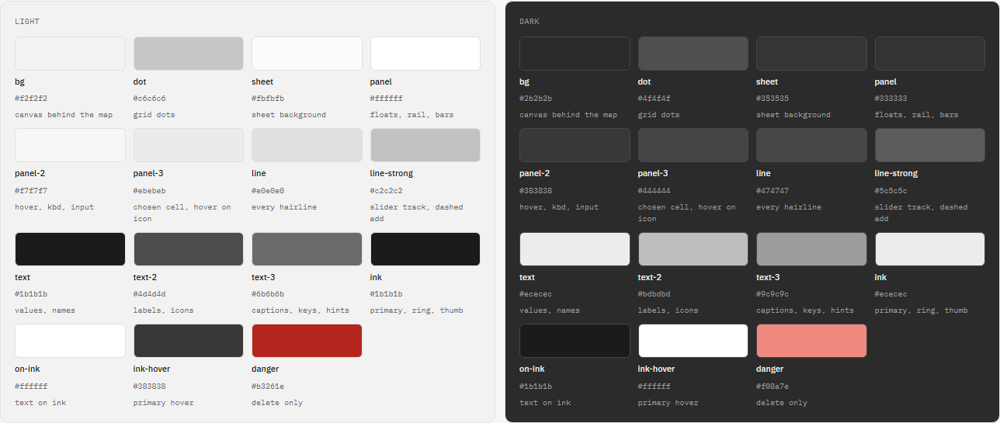

| Token | Light | Dark | Role |
|---|---|---|---|
| bg | #f2f2f2 | #2b2b2b | canvas behind the map |
| dot | #c6c6c6 | #4f4f4f | grid dots |
| sheet | #fbfbfb | #353535 | sheet background |
| panel | #ffffff | #333333 | floats, rail, bars |
| panel-2 | #f7f7f7 | #383838 | hover, keycap, input |
| panel-3 | #ebebeb | #444444 | chosen cell, hover on an icon button |
| line | #e0e0e0 | #474747 | every hairline |
| line-strong | #c2c2c2 | #5c5c5c | slider track, dashed add tile |
| text | #1b1b1b | #ececec | values, names |
| text-2 | #4d4d4d | #bdbdbd | labels, icons |
| text-3 | #6b6b6b | #9c9c9c | captions, keys, hints |
| ink | #1b1b1b | #ececec | primary button, active ring, slider thumb |
| on-ink | #ffffff | #1b1b1b | text on ink |
| ink-hover | #383838 | #ffffff | primary hover |
| focus | rgb(27 27 27 / 0.14) | rgb(236 236 236 / 0.18) | focus outline |
| danger | #b3261e | #f08a7e | delete only |

Shadows: `shadow-sm` on chips, `e-shadow` on floats, `shadow` on sheets. Values are in the page.

Rules. Text on a panel uses text for values, text-2 for labels, text-3 for captions and keys. Lines are hairline only, 1px, line at rest and line-strong for slider tracks. Danger is reserved for delete. No second accent anywhere. Light is the default; dark follows the existing `dark` class on `<html>` from `canvas/src/v2/theme.ts`.

### 4.2 Type

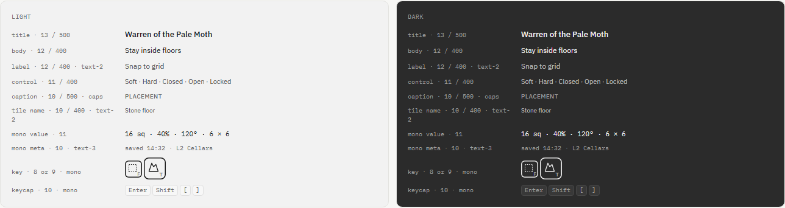

IBM Plex Sans for words, IBM Plex Mono for numbers, keys, times and ids. Title 13/500. Body 12. Label 12 in text-2. Control text 11. Caption 10/500 uppercase with 0.04em tracking. Tile names 10 in text-2. Mono values 11, mono meta 10 in text-3. Key letters 8px at 28 and 9px at 36. Nothing on the chrome is larger than 13px. Tabular numerals wherever a number can change width.

### 4.3 Spacing, shape, elevation

Base unit 4px. Scale 4, 6, 8, 10, 12, 16. 12px from every screen edge and 12px between floats. 8px between a float's edge and its content, 12px on the left of text rows. 6px between tiles, 2px between icon buttons in a row, 10px between rail buttons. Radius 8 for floats, 6 for controls and tiles, 4 for keycaps and level rows, pill for chips and the switch. One shadow for floats, none on controls.

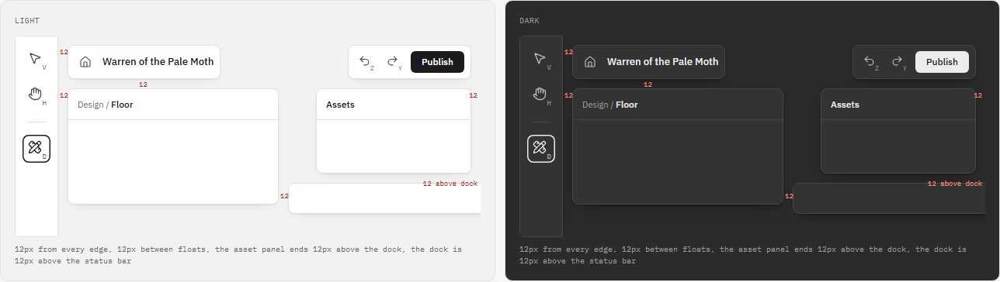

### 4.4 Icon button with key

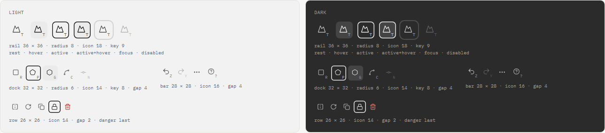

Four sizes: rail 36 with an 18px icon and a 9px key, dock 32 with a 14px icon, bar 28 with a 16px icon, row 26 with a 14px icon. Six states: rest, hover (panel-3 fill), active (1.5px inset ring in ink, no fill), active plus hover (both), focus (2px outline in the focus token, offset 1px), disabled (38% opacity). The key letter sits in the bottom right corner in mono, text-3, 3px from the edges at 28 and 5px at 36. When a button has a key its icon moves 1.5px up and left (2px at 36) so the letter owns its corner. Buttons without a key keep the icon centred. The icon never moves between states. Danger is last in any row.

### 4.5 Buttons, chips, keycaps, controls

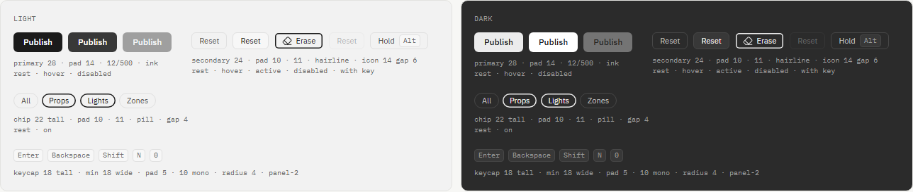
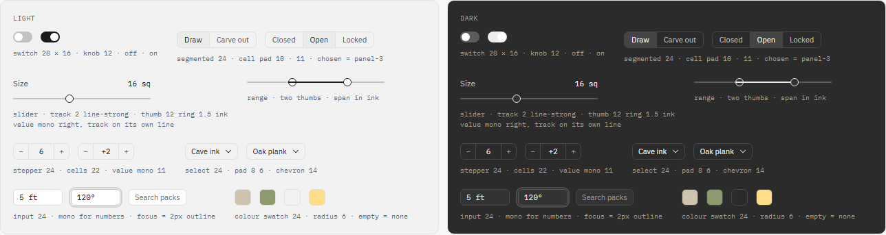

| Control | Height | Side padding | Notes |
|---|---|---|---|
| Primary button | 28 | 14 | ink fill, 12/500, one per surface |
| Secondary button | 24 | 10 | hairline, 11, icon 14, gap 6 |
| Segmented cell | 22 | 10 | chosen cell is panel-3, no ring |
| Chip | 22 | 10 | pill, on state is the ring |
| Input and select | 24 | 8 | mono for numbers, focus is the 2px outline |
| Keycap | 18, min width 18 | 5 | mono 10, panel-2 |
| Switch | 28 by 16 | | knob 12 always white, track line-strong off and ink on |
| Slider | track 2 | | thumb 12 with a 1.5px ink ring, value mono right, track on its own line |
| Stepper | 24 | cells 22 | value mono 11 |
| Colour swatch | 24 | | radius 6, empty means none |

### 4.6 Tiles, setting rows, headers, dock columns, bars, overlays

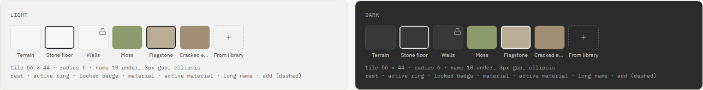
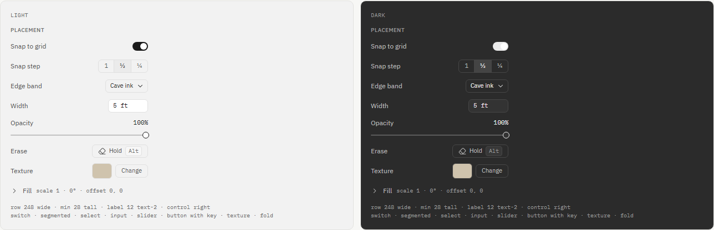
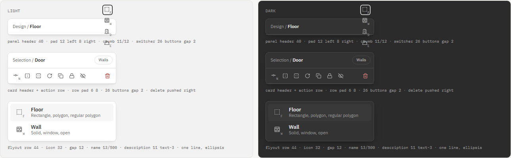
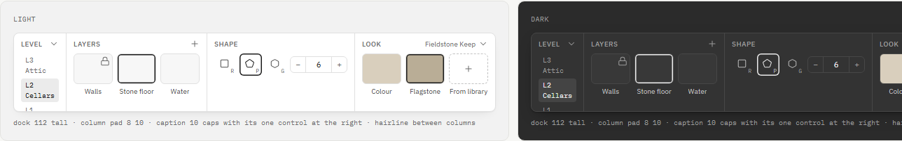
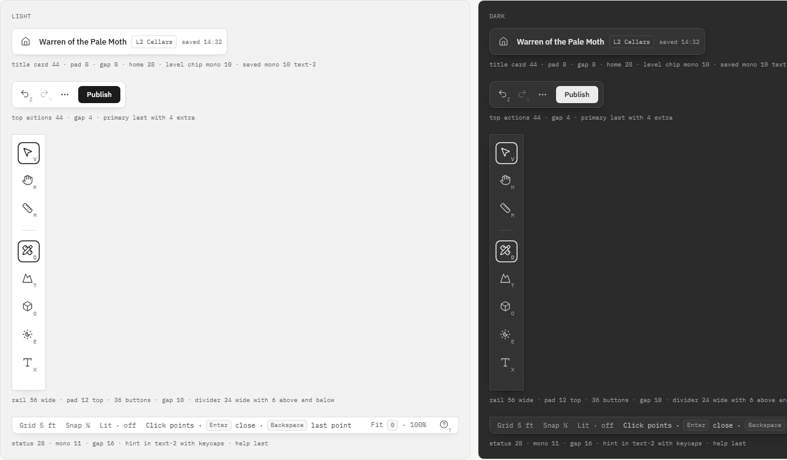
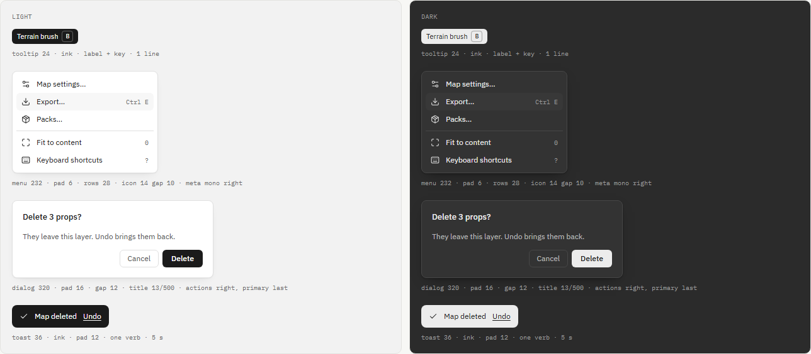

Tile 56 by 44, radius 6, name 10 under with a 3px gap and ellipsis, active ring, lock badge top right, dashed add tile. Setting row 248 wide, 28 minimum, label left in text-2, control right; a slider row puts the value beside the label and the track on the next line; folds collapse to one line with a mono summary. Panel header 40 tall with a breadcrumb at 11/12 and the switcher row of 26px buttons. Action row 26px buttons, gap 2, delete pushed right. Flyout row 44 tall, 32px icon, name 13/500 over an 11px one-line description. Dock column: caption row with its one control at the right, then a strip; 8px top and bottom, 10px sides, hairline between columns; the dock is 112 tall and never changes height. Title card 44 with the home button first. Top actions 44 with Publish last. Status bar 28 in mono 11 with the hint in text-2 and keycaps, help last. Tooltips ink-filled, 24 tall, label plus key. Menus 232 wide, 6px padding, 28px rows. Dialogs 320 wide, primary last. Toasts ink-filled with one underlined undo verb.

## 5. The shell

Everything in this section is drawn in [mockups/shell.html](mockups/shell.html), light and dark. Builders match the frames.

### 5.1 Frame A: a family clicked, flyout open

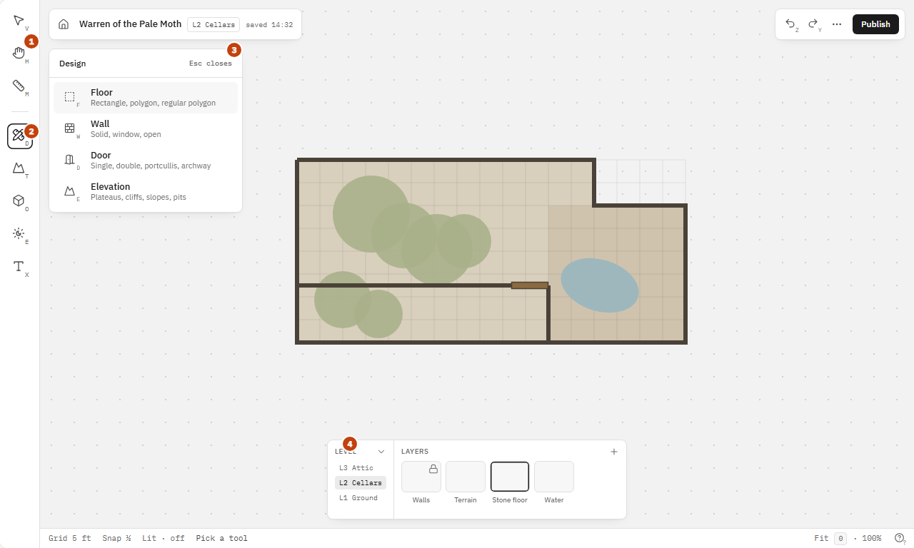

- Rail, 56 wide: Select (V), Pan (H), Measure (M), a divider, then Design (D), Terrain (T), Objects (O), Environment (E), Text (X). 36px buttons, 10px apart, 12px top padding. The active family and the active global tool show the ring.
- Flyout in the slot beside the rail (left 68, top 68, width 272): header with the family name and "Esc closes", one row per tool with the icon and key, the name and a one-line description. Opens on click, closes on pick or Escape, never on hover.
- Dock shows level and layers before a tool is picked.

### 5.2 Frame B: a tool picked, panel in the same slot

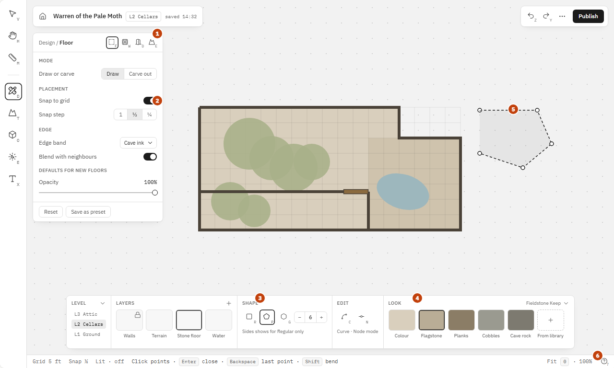

- The panel replaces the flyout in the same box. Header: breadcrumb "Design / Floor" and a switcher row of the family's tools so changing tool does not need the flyout again. The panel stays open while drawing.
- Panel body is setup only, in captioned sections: Mode (Draw or Carve out), Placement (Snap to grid, Snap step), Edge (Edge band, Blend with neighbours), Defaults for new floors (Opacity). Foot: Reset, Save as preset.
- Dock: Level column, Layers column, Shape column (rectangle, polygon, regular polygon with the Sides stepper beside it; the stepper shows only when Regular is picked), Edit column (Curve, Node mode), Look column (colour, style presets dropdown, texture strip, From library).
- Status bar hint carries the tool's keys as keycaps. The help button is last.
- Dark theme is the same frame with the dark tokens: 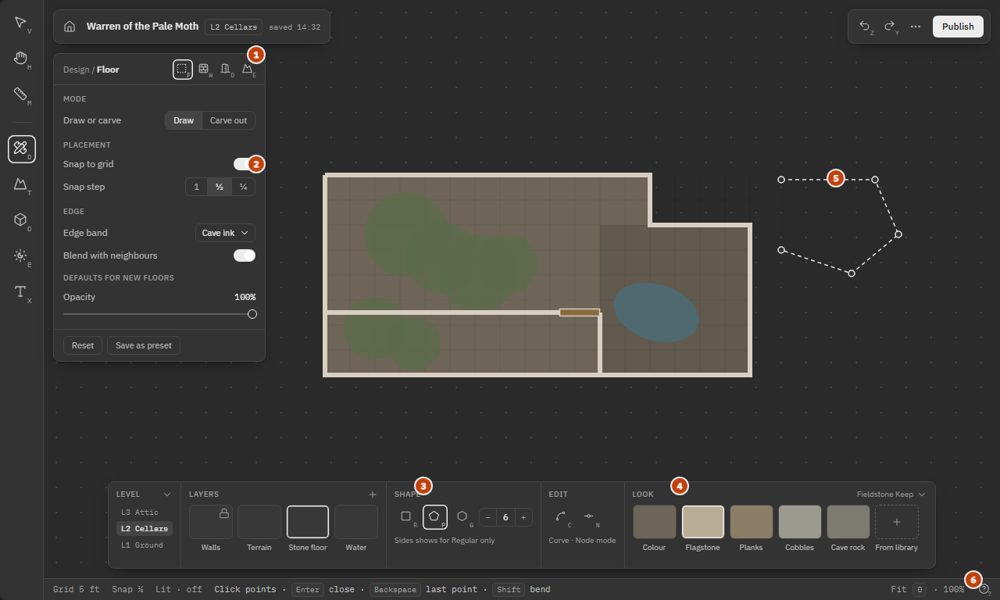

### 5.3 Frame C: Select, nothing picked

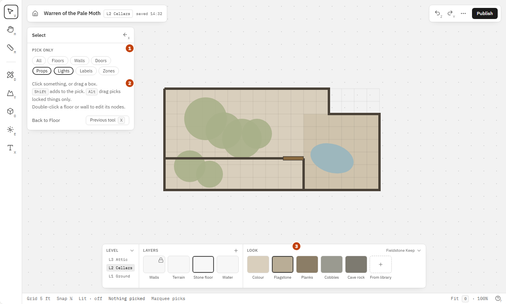

- Select's panel: a Pick only chip row (All, Floors, Walls, Doors, Props, Lights, Labels, Zones) that filters what a box select grabs, a short how-to with keycaps, and Previous tool (X).
- Dock keeps the last family's Look column so a texture pick is one click away. Shape and Edit columns go because Select does not draw.
- Right side is empty; the asset library is closed.

### 5.4 Frame D: Select, a floor picked

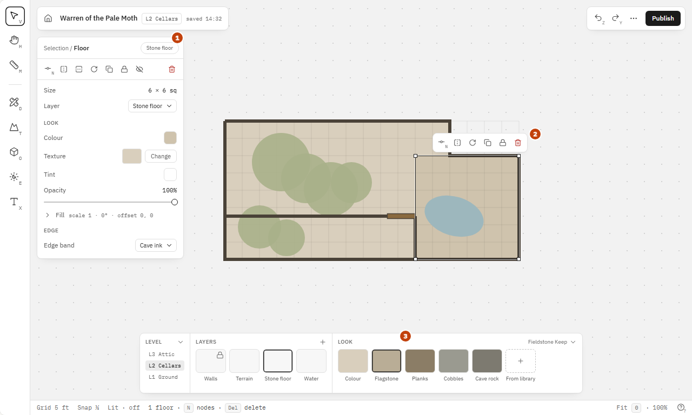

- The floor card in the slot: breadcrumb "Selection / Floor" with the layer chip, the action row (Node mode N, flip, flip, rotate, duplicate, lock, hide, delete), then Size and Layer, Look (Colour, Texture with Change, Tint, Opacity, a Fill fold), Edge (Edge band).
- The floating action bar stays beside the selection with the same verbs; Node mode is on it too.
- Dock highlights the selection's layer; clicking a Look swatch applies to the selection.

### 5.5 Surfaces not drawn in round two, carried over from round one

- Asset library: right 12, top 68, width 320, bottom edge 12px above the dock. Header "Assets" with the count and a close button, a search box, type chips (Textures, Props, Walls, Paths, Lights), then a pack caption and a four-column grid. Opens from From library in the dock, from any texture Change on a card, and from the Objects family. Closes with X and stays closed.
- Title card: home button, map name, level chip in mono, saved time in mono.
- Top actions: Undo (Z), Redo (Y), the "…" menu (Map settings, Export, Packs, Import image, Fit to content, View toggles, Lit preview, Focus mode, Keyboard shortcuts), Publish.
- Status bar: grid, snap, lit chip, the one-slot hint line (drop target, live ruler, node keys, or the tool's own hint), selection summary, solo-exit chip, zoom and Fit, help.
- Tooltips, context menus and the floating action bar keep working as today, restyled from the design system.
- Sheets (Layer, Layers, Sky and mood as reworked, Packs, Shortcuts, Rooms list, Zone, Prep overview) keep their slot on the right at 320 wide and are rebuilt from the same components.

### 5.6 Defaults taken where no decision was recorded

Veto any of these and the mockup changes before the code does.

- Carve out is a panel mode and also a held Alt while drawing, shown in the status hint. Both, because the panel is the visible truth and the key is the fast path.
- Sides is hidden unless Regular polygon is picked. The dock's height never changes, so a hidden stepper costs nothing.
- Edge band is a default in the Floor panel and a per-floor field on the card.
- Shortcut letters in the mockups are placeholders. The final table is produced by the registry (section 7.4) and shown in the shortcuts sheet; conflicts fail a test.

## 6. Tool families, settings and their homes

The full per-setting record is [mockups/settings-audit.html](mockups/settings-audit.html), filterable by verdict and family. This section is the build list derived from it. Home means where the setting renders: Dock, Panel, Card or Sheet.

### 6.1 Design

Tools: Floor (one tool, shape row), Wall, Door, Elevation.

Floor. Dock: shape row (rectangle, polygon, regular polygon), Sides stepper for Regular only, Curve toggle, Node mode toggle, colour swatch, style presets (five, delete the dead All styles popover), texture strip, From library. Panel: Mode Draw or Carve out, Snap to grid, Snap step, Edge band, Blend with neighbours, default Opacity. Card: Size, Layer, Colour with reset, Texture with Change, Tint, Opacity, Fill fold (Scale, Rotate, Offset X and Y), Edge band. Removed: the wall width slider on the floor tools (it edited the layer's wall width and was labelled Wall here and Width there), the Outline idea. Dungeondraft: Building tool and Pattern shape tool for the shape row, carve out (ALT drag there, a visible mode here), Edit Points for Node mode.

Wall. Dock: Type (Solid, Window, Open), Width, Wall tint, presets and set strip, Corner style (rounded or sharp, per wall; wall sets ship with both corner pieces), Curve, Node mode. Panel: Snap, Auto-join at an endpoint (on). Card: Length, Type, Set (editable), Stones, Merge verb when two walls are picked, Shadow once the renderer casts wall shadows. Removed: over or under sorting. Dungeondraft: Wall tool (CTRL continue, Merge in Select, bevel corners, shadow).

Door. Dock: Style (Single, Double, Portcullis, Archway), Width, Angle with Turn 90. Panel: Secret, Freestanding (new: a door not on a wall, 5° rotation). Card: Name, Style, State (Closed, Open, Locked), Opens to, Secret, Width, Angle, Material, Hinge, Swing, Hinges. Material and Hinges list what the pack's door assets provide, with pack defaults, customisable per door. Block light follows State. Dungeondraft: Portal tool (Anchored or Freestanding, rotate 180, block light).

Elevation. Dock: Height stepper, Edge (None, Slope, Cliff). Card: Height with its readout, Edge, Cliff art, Slope width (fix the "cells a cell" hint), Contour lines, Blocks sight (one switch, Auto default, replacing the Auto, Always, Never three-way whose Always meant hides), Crossing. No cave brush. Dungeondraft: Cave brush page, for what we are deliberately not building.

### 6.2 Terrain

Tools: Terrain brush, Water brush (new), Material brush (new), Path (new).

Terrain brush. Dock: Size (with [ and ] and the wheel), Strength, texture slots (six), Biome dropdown that fills the slots, From library. Panel: Smooth blending, Fill enclosed floor, Erase mode (back to the floor's own texture), Colour controls (one colour with alpha for single-colour art, a colour per region for art that declares regions; replaces the Tint and Tint opacity pair). Sheet: terrain layer Visible and Opacity. Known bug to fix in the same pass: the strength, opacity and fill sliders do nothing today. Dungeondraft: Terrain brush (slots, intensity, smooth blending, fill, biomes).

Water brush. Dock: Size, brush or shape (brush first, shapes later). Panel: Shallow colour, Deep colour, Blend distance, Border on or off, Erase mode. Later, after the brush is good: the below-water layer that tints props under water. Dungeondraft: Water brush.

Material brush. Dock: Size, material swatches. Panel: Smooth, Border on or off, Erase mode. Paints a freehand patch; on release the pack's border art closes it, one solid piece, "like scatter tool but fuller". The cave band renderer already draws edge bands along an outline and is the starting point. Dungeondraft: Material brush.

Path. Dock: Width, Smoothness, Curve, Node mode, piece swatches. Panel: Transition in and out (hard, fade, grow or shrink), Snap. Card: Width, Smoothness, Transitions (editable after placing, unlike Dungeondraft), Block light. Renders as individual unit pieces laid along the path, never stretched strips. Dungeondraft: Path tool.

### 6.3 Objects

Tools: Stamp, Scatter (one Props tool with a mode toggle is acceptable if the registry models them as two tools sharing a pool).

Stamp. Dock: Scale, Angle chip (wheel 15°, fine step with a modifier, click resets), Mirror, Variant stepper with a Random position at the end (replaces the Vary each stamp toggle), Tint before placing with live preview in the library, prop strip (recent, picked, favourites), Library. Panel: Keep placing, Place under (once, shared with Scatter). Card: Transform (X, Y, W, H, ratio lock, Angle, Flip H and V), Look (Tint, Opacity), Layering (to back, backward, forward, to front, Overhead, Lock; the Mixed card gets the same four), Variant with Replace, Behaviour (Casts shadow, Blocks light and sight). Removed: Glows, Blocks movement. Dungeondraft: Objects tool (colourable assets preview, shadow, block light, tags, Used tab).

Scatter. Dock: Radius, Density, Re-roll. Panel: Scale range, Rotation range (two ends), Spacing, Avoid overlaps, Stay on floors, Random variant with a multi-asset pool, Tints up to four, Place under. Removed: the visible seed, the See under overhead toggle (moves to the View menu). Dungeondraft: Scatter tool.

Asset library. Search, type chips, tag sets, a Used filter, packs, colourable preview, Save as prefab from a group. Dungeondraft: Objects tool library, Prefabs tool.

### 6.4 Environment

Tools: Light. Sheet: Sky and mood, reworked.

Light. Dock: Bright, Dim (fix the default bright of 0 below the slider minimum), Intensity (moved here from the card), Colour, presets (Torch, Lantern, Candle, Brazier, Magical, Darkness). Panel: Cone, Direction, Effect (None, Flicker, Pulse), Speed, Through walls. Card: Attach or Detach, the same fields, and under a Table caption only On at the table. Removed: the Flicker switch (duplicated Effect twice), Falloff, Night only, Darkvision sees through, the Darkness toggle (the preset covers it). Later: light shapes when assets arrive. Dungeondraft: Light tool.

Sky and mood sheet, rebuilt around what renders: Environment (Outdoor, Indoor, Underground), Natural shadows, Orientation, Mood tint, the Preview block with Lit preview. Removed: Climate, Weather, Night sky, Time (follow clock and fixed hour). Room Mood (Lit, Dim, Dark, tint, Dark hides from sight) is removed from the room, area and level cards. Maps that carry these fields load without them; the map format test covers the migration.

### 6.5 Text

Tools: Label, Zone, Rooms (Rectangle room, Polygon room, Divide), Prep overview.

Label. Dock: Size, Colour, style tiles (Room name, Door tag, GM note, Number pin, Callout, Custom). Panel: Font (two or three faces). Card: text, Follows or Unbind, Style, Size, Colour, Weight, Backdrop, Align, Angle, Visible to players. View menu gets a hide-all-labels toggle. Dungeondraft: Text tool.

Zone. Dock: Shape (Point, Circle, Rect). Card: Name, X, Y, R or W and H, Shape rendered as a word, Triggers, More, Prep overview.

Rooms. Dock: the three tools, Divider (Threshold or Wall), the floor texture strip (missing today, the code comment promises it). Panel: Walls With room or None, Suggest rooms with Accept all and Dismiss. Card: Number, Name, Size, Area, Floor, Walls, Key. Area and Level cards keep Name, Rooms, Layers and the look sections minus Mood. Level column in the dock gets Clone on create and Compare levels with opacity. Moved to the View menu: Outlines, Labels Off, Numbers, Both. Dungeondraft: Level settings.

### 6.6 Select

Panel: Pick only chip row, how-to, Previous tool (X), and when something is picked the kind's card. Verbs: Flip H, Flip V, Rotate 90, Duplicate, Lock, Unlock, Hide, Delete, More, plus Merge for two walls. Mixed card: Move to layer, Align, Distribute, Order (four), Select only per kind, shared fields when all one kind. Locked members hold the group back and the header says how many. Dungeondraft: Select tool pages.

### 6.7 Map wide

Layer sheet unchanged in content, rebuilt from the components. Background layers get Opacity and a quick toggle key so an imported image works as a trace. Plateau rules stay on the map settings sheet. Removed: nothing else. Not added: camera filters, building wear.

### 6.8 Code smells to fix in the same pass

- Floors All styles popover can never open (row of seven, five presets). Delete it.
- Light default bright is 0 ft, slider minimum is 5 ft.
- Flicker switch in the Lights dock duplicates Effect twice.
- Place under appears in both Stamp and Scatter popovers and writes one field.
- Plateau Sight Always means hides, undo label says Blocks sight, slope hint reads "cells a cell".
- Wall width labelled Wall on floor tools and Width on the Wall tool; Floor colour labelled Floor in the dock and Colour on the card.
- `wallWidth` and `brushRadius` in tool settings are not read by v2; `wallDirection` is read but nothing sets it.
- Rooms tools never get the floor texture strip.
- Zone card prints the raw shape kind.
- Mixed card offers two Order buttons, the prop card four.
- Assets tab has no tools and only repeats the library button.
- No selection card for terrain; water does not exist in v2.

## 7. Frontend architecture

### 7.1 Four layers, each importing only from the one below

1. Primitives: shadcn components generated into `canvas/src/ui` from `components.json` (Base UI, lucide). Button, Toggle, ToggleGroup, Slider, Switch, Select, Popover, Tooltip, Dialog, DropdownMenu, ContextMenu, Tabs, ScrollArea, Separator, Kbd, Input. Regenerated with the shadcn CLI, then themed through the tokens, never edited per feature.
2. Composites in `canvas/src/editor/components`: `IconKeyButton` (size 26, 28, 32, 36; key optional; the icon offset rule), `PrimaryButton`, `SecondaryButton`, `Chip`, `Seg`, `Stepper`, `SliderRow`, `SwitchRow`, `SelectRow`, `InputRow`, `ColourRow`, `Caption`, `SettingRow`, `Fold`, `Tile`, `AddTile`, `Swatch`, `KeyHint`, `FloatBox`, `PanelHeader`, `ActionRow`, `FlyoutRow`, `DockColumn`, `LevelList`, `StatusChip`. Each has one file, one test, one entry in the gallery.
3. Surfaces in `canvas/src/editor/surfaces`: `Rail`, `Slot` (hosts `Flyout` and `ToolPanel`), `Dock`, `Card`, `AssetPanel`, `TitleCard`, `TopActions`, `StatusBar`, `Sheet`, `FloatingActions`, `Tip`. Surfaces know layout and the registry, nothing about any one tool.
4. Families in `canvas/src/editor/families/{design,terrain,objects,environment,text,select}`: each exports a `FamilyDef` and owns its custom dock columns, card bodies and the model and write files that move over from `canvas/src/v2/editor`.

The shell in `canvas/src/editor/shell/EditorShell.tsx` composes surfaces. `canvas/src/v2` is deleted when the last family moves.

### 7.2 Styling

One tokens file, `canvas/src/theme/tokens.css`, holding the 16 v2 tokens for `:root` and `.dark`, plus the shadows, radii and the font faces. Tailwind reads them through `tailwind.config.ts` with the v2 names only (`bg-panel`, `text-text-2`, `border-line`, `ring-ink`); the Moss names and values are removed from `index.css` and the config. Components style with Tailwind classes and `cva` variants. No feature-level CSS files. The one exception is the canvas host and overlays that draw on the map, which keep their own CSS.

### 7.3 The registry

```ts
// canvas/src/editor/registry/types.ts
export type Home = 'dock' | 'panel' | 'card';
export type Control =
  | 'slider' | 'range' | 'switch' | 'seg' | 'select' | 'stepper'
  | 'input' | 'colour' | 'swatches' | 'button' | 'custom';

export interface SettingDef<T = unknown> {
  id: string;                  // 'floor.opacity'
  label: string;
  schema: z.ZodType<T>;        // validates writes and loads
  default: T;
  home: Home;
  control: Control;
  section?: string;            // caption in the panel or card
  options?: ReadonlyArray<{ value: T; label: string }>;
  range?: { min: number; max: number; step: number; unit?: string };
  render?: ComponentType<SettingProps<T>>;   // only for control 'custom'
}

export interface ToolDef {
  id: string;                  // 'floor'
  label: string;
  description: string;         // the flyout's second line
  icon: LucideIcon;
  key: string;                 // one letter, unique within the rail and the family
  settings: SettingDef[];
  dock: DockColumnDef[];       // ordered columns after Level and Layers
  hint: (state: EditorState) => HintLine;   // the status bar line
}

export interface FamilyDef {
  id: 'design' | 'terrain' | 'objects' | 'environment' | 'text';
  label: string;
  icon: LucideIcon;
  key: string;
  tools: ToolDef[];
}

export interface CardDef<K extends ObjectKind> {
  kind: K;
  title: (o: ObjectOf<K>) => string;
  verbs: Verb[];
  fields: SettingDef[];        // home is always 'card'
}
```

Rules enforced by `registry.test.ts`: every setting id is unique; every setting has exactly one home; keys are unique within the rail and within each family; every `custom` control has a render; every default parses against its schema; every tool has a hint. The shortcuts sheet and the status hints are generated from the registry, not written by hand.

Worked example, the Floor tool:

```ts
export const floor: ToolDef = {
  id: 'floor', label: 'Floor', description: 'Rectangle, polygon, regular polygon',
  icon: SquareDashed, key: 'F',
  settings: [
    { id: 'floor.shape', label: 'Shape', schema: z.enum(['rect', 'polygon', 'regular']), default: 'rect', home: 'dock', control: 'seg' },
    { id: 'floor.sides', label: 'Sides', schema: z.number().int().min(3).max(32), default: 6, home: 'dock', control: 'stepper', range: { min: 3, max: 32, step: 1 } },
    { id: 'floor.curve', label: 'Curve', schema: z.boolean(), default: false, home: 'dock', control: 'switch' },
    { id: 'floor.nodeMode', label: 'Node mode', schema: z.boolean(), default: false, home: 'dock', control: 'switch' },
    { id: 'floor.mode', label: 'Draw or carve', schema: z.enum(['draw', 'carve']), default: 'draw', home: 'panel', control: 'seg', section: 'Mode' },
    { id: 'floor.snap', label: 'Snap to grid', schema: z.boolean(), default: true, home: 'panel', control: 'switch', section: 'Placement' },
    { id: 'floor.snapStep', label: 'Snap step', schema: z.enum(['1', '1/2', '1/4']), default: '1/2', home: 'panel', control: 'seg', section: 'Placement' },
    { id: 'floor.edgeBand', label: 'Edge band', schema: z.string(), default: 'cave-ink', home: 'panel', control: 'select', section: 'Edge' },
    { id: 'floor.blend', label: 'Blend with neighbours', schema: z.boolean(), default: true, home: 'panel', control: 'switch', section: 'Edge' },
    { id: 'floor.opacity', label: 'Opacity', schema: z.number().min(0).max(1), default: 1, home: 'panel', control: 'slider', section: 'Defaults for new floors', range: { min: 0, max: 1, step: 0.05, unit: '%' } },
  ],
  dock: [lookColumn({ colour: true, presets: FLOOR_PRESETS, textures: 'floor' })],
  hint: floorHint,
};
```

The store keeps one `toolSettings` slice keyed by setting id, written through `setSetting(id, value)` which parses with the schema and rejects bad values, and loaded from prefs through the same parse. Map objects keep their own fields; card `SettingDef`s read and write the object through the existing command layer (`packages/core/src/store/commands.ts`) so undo keeps working.

### 7.4 Shortcuts

`defaultShortcuts.ts` becomes two parts: global chords that stay hand-written (undo, redo, save, publish, fit, lit preview, focus) and tool and family keys that come from the registry. `formatCombo.ts` stays. The shortcuts sheet lists both. A test fails on any collision.

### 7.5 Validation

zod at three boundaries: tool settings (the registry), the map file on load and save (`canvas/src/v2/mapFile.ts` moves to `canvas/src/io/mapFile.ts` with a schema per version and the removed fields handled), the publish payload. Types derive from schemas where a schema exists.

### 7.6 Modularity for later gates

Nothing is gated now. The registry gives every tool, setting and verb an id and one renderer, so if a gate is ever wanted it is one lookup in the surface that renders it. No code for that is written in this plan.

### 7.7 What is deleted at the end

`canvas/src/v2/v2.css`, the fifteen CSS files under `canvas/src/v2/editor`, `canvas/src/v2/editor/controls.tsx`, `dockTabs.ts`, `Dock.tsx`, `DockControls.tsx`, `LightsDock.tsx`, `PropsDock.tsx`, `RoomsDock.tsx`, `SelectionCard.tsx` and the per-kind card files once their fields live in `CardDef`s, `Rail.tsx`, `TitleCard.tsx`, `TopActions.tsx`, `StatusBar.tsx`, `SlideOver.tsx`, `FloatMenu.tsx`, `TipLayer.tsx`, the Moss tokens in `index.css` and `tailwind.config.ts`, everything in `canvas/src/ui` that was not regenerated, and finally the `canvas/src/v2` folder itself. Deleting is part of the work, not a follow-up.

## 8. Work plan for three builders

### 8.1 Workstreams

| Builder | Workstream | Owns |
|---|---|---|
| A | Foundation | tokens file, Tailwind config, shadcn regeneration, the composites, the gallery route, deletion of Moss and the old ui folder |
| B | Shell and registry | registry types and tests, surfaces, EditorShell, Select family, shortcuts from the registry, asset panel, status bar, Playwright for the shell |
| C | Families | Design, Terrain, Objects, Environment, Text family definitions, card definitions, dock columns, the audit's drops, moves and UI-only adds, the smells, map format migration for removed fields |

### 8.2 Order

All work happens on one local branch in the main checkout. No worktrees, no per-step branches, no pull request until the whole thing is done and asked for. Each step ends in one commit on that branch.

1. Builder A lands the foundation first and commits it. B and C start only after that commit exists.
2. B and C run in parallel when their files do not collide: B owns anything under `surfaces`, `registry`, `shell` and the Select family; C owns anything under `families` other than Select. Where a step touches the other's files (shared store slice, shortcuts, the shell wiring) they run sequentially, B first. A reviews both for design-system fidelity against the gallery.
3. Integration: B wires the families into the shell, C deletes the v2 folder, A deletes the last CSS. One commit, all three review.
4. Phase two, after the shell ships: the adds that need renderer work (section 8.5).

### 8.3 Steps and commits

One commit per step, in this order. Commit subjects and bodies stay under 100 words, first person, no tooling mentioned. Each step is green on `pnpm check` and on the Playwright suite it touches before it is committed.

| # | Step | Builder | Contents | Done when |
|---|---|---|---|---|
| 1 | theme tokens | A | `theme/tokens.css`, Tailwind config with v2 names only, Moss removed from `index.css`, dark class wired | Gallery renders both themes from the tokens; no Moss name compiles |
| 2 | ui primitives | A | shadcn regenerated into `ui`, old files deleted, primitives themed | Every primitive in the gallery matches the design-system page |
| 3 | editor components | A | the composites with tests | Each composite has a test and a gallery entry; IconKeyButton passes the offset and state tests |
| 4 | gallery route | A | `/gallery` dev route that renders the design-system sections from the real components | Side-by-side with `mockups/design-system.html` shows no difference the eye catches |
| 5 | registry core | B | registry types, validation test, settings slice with zod writes | Test suite enforces the rules in 7.3 |
| 6 | shell surfaces | B | Rail, Slot with Flyout and ToolPanel, Dock, Card, TitleCard, TopActions, StatusBar, Tip, FloatingActions | Frames A to D reproduce with a stub family |
| 7 | select family | B | Select panel, Pick only filter, Previous tool, card host | Frame C and D pass Playwright |
| 8 | asset panel | B | AssetPanel with search, chips, grid, open triggers, never over the dock | Playwright: opens from three triggers, closes with X, bottom edge above the dock |
| 9 | shortcuts from the registry | B | keys from the registry, collision test, shortcuts sheet | Sheet lists every tool key; a duplicate key fails the test |
| 10 | design family | C | Floor (one tool), Wall, Door, Elevation defs, dock columns, cards, audit verdicts | Frame B passes Playwright with the real family |
| 11 | terrain family | C | Terrain brush def with blending, fill, erase, colour controls, slot and biome dock; the broken sliders fixed | Painting changes with strength and opacity in Playwright |
| 12 | objects family | C | Stamp and Scatter defs, pre-place tint, variant stepper, rotation range, Glows and Blocks movement removed | Playwright places and scatters with the new controls |
| 13 | environment family | C | Light def with intensity in the dock, drops applied, Sky and mood sheet rebuilt, map format migration | Old maps load; removed fields are gone from saves |
| 14 | text family | C | Label, Zone, Rooms defs, font, texture strip on rooms, view-menu moves, level clone and compare | Playwright draws a room and a label with the new dock |
| 15 | shell integration | B, C, A | families wired, v2 folder deleted, last CSS deleted, docs updated | Whole Playwright suite green; `canvas/src/v2` does not exist |

### 8.4 Tests

- Unit (vitest): every composite, the registry rules, the settings slice parse and reject, the map format migration, shortcut collisions.
- Component: the panel renders a tool's panel settings in section order and none of its dock settings; the dock renders the reverse; the card renders a kind's fields.
- Playwright (`canvas/tests/e2e`): one spec per frame A to D, one per family covering draw, pick, change a dock control, change a panel setting, undo; the asset panel triggers; the dock never changes height; the asset panel never overlaps the dock; help opens the shortcuts sheet.
- Visual: the gallery route is compared by eye against `mockups/design-system.html` in review; a screenshot of each frame is saved beside the step's notes for the reviewer.

### 8.4.1 Testing and budget rules

These hold for this step and every later phase.

1. Playwright runs are scoped and counted. While a spec is being rewritten, only that file runs, or one scope through its tag, never the whole suite. The full suite runs once, at the very end, when typecheck, lint and the unit tests are already green, on two workers and with no retries. If it fails, fix it and run only the failed files, then one final full run.
2. Only a run's summary line and the failing tests' names and errors are read, never the whole log, and never screenshots in a loop.
3. Screenshots are taken once, in one scripted run, after the suite is green. Nobody re-checks them by eye between runs. The temporary screenshot spec is deleted before the commit.
4. No helper builders for the rest of a step once this rule applies; the builder on the step finishes it alone.
5. The Playwright config keeps no retries, at most four workers locally and two in CI, and the one-line reporter so output stays small.

### 8.5 Phase two: adds that need renderer work

The phase-two plan, with the order, scope, mockup, test and budget per item, is [phase-2.md](phase-2.md). The table below is the original list; the terrain brush model (time-based build-up, intensity as rate, smooth blending, fill) was added to it on 7 November.

| Item | Needs | Reference |
|---|---|---|
| Carve out mode on Floor | polygon boolean subtract on floors (clipper is already a dependency) | Building tool, ALT drag |
| Node mode toggle | expose the existing Enter node editing as a dock state with midpoint handles | Wall tool, Edit Points |
| Corner style on walls | wall sets with curved and sharp corner pieces, renderer picks by corner flag | Wall tool, Bevel corners |
| Water brush | a water mask layer, shallow and deep colour, blend, border, erase | Water brush |
| Material brush | freehand mask plus the edge band renderer with per-material border art | Material brush |
| Path | unit pieces laid along a polyline, width, smoothness, transitions, block light | Path tool |
| Colour per region | packs declare colour regions; renderer tints per region; controls follow | Objects tool, colourable assets |
| Floor opacity | per-floor alpha in the floor renderer | Pattern shape tool, opacity |
| Terrain fill, blend, erase | flood fill inside a floor, blend mode, erase to floor texture | Terrain brush |
| Wall merge and auto-join | join on endpoint snap, Merge command | Wall tool, CTRL continue |
| Freestanding doors | a door object not bound to a wall edge | Portal tool, Freestanding |
| Save as prefab | serialise a group into a pack-local asset | Prefabs tool |
| Level compare and clone | render a second level at opacity; clone on create | Level settings |
| Trace image | opacity and a toggle key on background image layers | Trace image |
| Below water layer | tint props by the water mask, after the water brush ships | Water brush, Below Water layer |

## 9. Out of scope

The table client and the bot, until the canvas has launched. Entitlements, roles, plans and flags. Light shapes. Cave brush. Camera filters and building wear. Any change to the map renderer that is not listed in 8.5.

## 10. Decision log

| Date | Decision |
|---|---|
| 6 Nov 2026 | Rail owns the families; flyout and tool panel share one slot; dock is swatches plus on-the-fly controls; panel is setup; Select is a tool; asset library on demand, never over the dock |
| 6 Nov 2026 | Home stays in the map-name card; help is a question mark at the end of the status bar |
| 6 Nov 2026 | Keys at the icon corner, icon offset up-left when a key is present; active is the outline ring, no tint |
| 6 Nov 2026 | One Floor tool with a shape row; Floors stay floor only; wall sets ship both corner styles; floor opacity must work; door material and hinges come from pack assets |
| 6 Nov 2026 | No cave brush; material brush is its own Terrain tool; water brush first, below-water later; proper colour controls replace the two-slider tint |
| 6 Nov 2026 | Glows dropped; environment rebuilt around what renders; climate, weather, moon, time of day, night only, darkvision and room Mood dropped; light shapes later |
| 6 Nov 2026 | All ten audit drops confirmed; moves and adds approved |
| 6 Nov 2026 | shadcn stays as the only primitive layer; composites on top with strict spacing; Moss theme and old ui folder deleted; v2 tokens are the design system, verified on the design-system page |
| 6 Nov 2026 | Canvas only now; the table follows after launch; no entitlements of any kind |
| 6 Nov 2026 | Everything visual is agreed as a mockup before it is built |
| 7 Nov 2026 | The registry binds each setting to a path in the core store's tool settings; there is no second settings store, and undo stays with the command layer |
| 7 Nov 2026 | Settings several tools share (snap, snap step, curve, erase, node mode) are defined once in `registry/shared.ts` and referenced by each tool; Place under is one setting for Stamp and Scatter |
| 7 Nov 2026 | Controls whose renderer work is phase two (Carve out, default floor opacity, corner style, water, material brush, path) are not registered, so nothing shows that does nothing |
| 7 Nov 2026 | Regular polygon starts at 6 sides |
| 7 Nov 2026 | Keys: Select V, Pan G, Measure M; Design D, Terrain T, Objects O, Environment E, Text X; Floor F (shapes R, P, H in the dock), Wall W, Door S, Elevation L; Terrain brush B; Stamp S, Scatter C; Light L; Label A, Zone Z, Rectangle room R, Polygon room P, Divide K; Q goes back from Select to the previous tool |
| 7 Nov 2026 | The Scatter rotation range was built in step 12, so it left the phase-two list |
| 7 Nov 2026 | Holding Space pans with any tool and hands the tool back on release |
| 7 Nov 2026 | Terrain strength: a stroke blends from the paint under it, with strength as its ceiling. Revisiting that model and the 0.4 display threshold is phase two |
| 7 Nov 2026 | The label Font setting and the level clone and compare controls are phase two |
| 7 Nov 2026 | Dialogs follow the design system: 320 wide, except New map and Map settings at 440 because their rows do not fit; the home page keeps its layout on the tokens |
